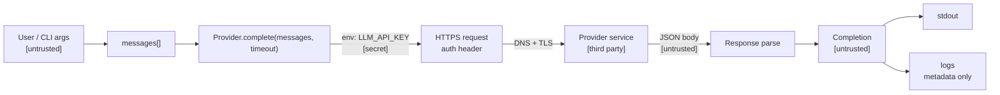

# Data Flow and Trust Boundaries

Request path from CLI to stdout. `[untrusted]` = do not trust for
authorization. `[secret]` = env-only, header-only. `[third party]` = provider
sees the full payload.

## Mermaid



## ASCII

```
user text [untrusted]
        │
        ▼
  messages[] ──► Provider.complete(messages, *, timeout)
                        │
        env LLM_API_KEY [secret] ──► auth header only
                        │
                        ▼
              HTTPS  ──►  Provider service [third party]
                        │
                        ▼
              JSON body [untrusted]
                        │
                        ▼
              Completion [untrusted]
                   │           │
                   ▼           ▼
                stdout       logs (metadata only)
```