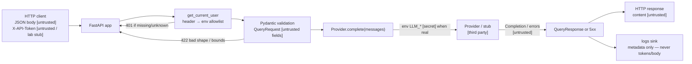

# HTTP API Trust Boundaries

Request path for `POST /v1/query`. `[untrusted]` = do not trust for
authorization or as verified content. `[secret]` = env-only.
`[third party]` = provider sees the full message payload.
`[lab stub]` = header token check is **not** production authn.

## Mermaid



## ASCII

```
HTTP client
  JSON body ............... [untrusted]
  X-API-Token ............. [untrusted / lab stub — not prod auth]
        │
        ▼
  FastAPI ──► get_current_user (header vs env TOKEN_* allowlist)
        │         missing/unknown → 401
        ▼
  Pydantic QueryRequest validation
        │         bad shape / bounds → 422
        ▼
  Provider.complete(messages, timeout)
        │         real path: LLM_API_KEY [secret] → provider [third party]
        ▼
  Completion / ProviderError ........ [untrusted]
        │
        ├──────────────────► HTTP JSON response (content [untrusted])
        └──────────────────► logs (metadata only; never token or full body)
```

## What is trusted server-side today

- **Our code paths** after validation: routing, `get_provider` allowlist (`mock`/`real`),
  status-code mapping (`400` / `422` / `401` / `502` / `500`).
- **Env allowlist for tokens:** `TOKEN_ALICE` / `TOKEN_BOB` (and other `TOKEN_*`
  keyed off `USERS`) as the server-side map used by `token_to_username()`.
- **Env for provider config:** `LLM_API_KEY`, `LLM_BASE_URL`, `LLM_MODEL`,
  `LLM_TIMEOUT` — secrets stay env-only, not in request JSON or logs.

## What is not trusted

- **Client JSON** (`question`, `provider`, `model`, `timeout`) — untrusted input;
  never use for authorization.
- **`X-API-Token` as production auth** — client-controlled header; the lab stub
  only checks it against an env allowlist. Not sessions, OIDC, or signatures.
- **Completion text** — model/provider output is untrusted; treat like any other
  third-party string (no shell/DB/authz decisions on its content).
- **Provider** — third party (or stub); errors and response shapes are untrusted;
  unexpected shapes map to a safe **500** detail.
- **System/Model test** — System and model text are not an access-control boundary. 
  System prompts and completion text may steer behavior; they do not authorize access.
  Real authz stays in server-side checks 
  (and later: DB policies, tool wrappers)—never “the model said so.”

## Authn stub ≠ authz

`get_current_user` is a thin **authn** stub (who called: alice or bob).
It is **not** authorization. Today alice and bob can both call `/v1/query`
equally — there is no per-user ACL, tenant isolation, or tool/doc gating.
